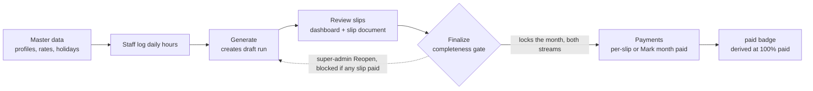

# Payroll — HR / admin operator guide

The month's payroll in one page: what must be true before a run, how a run is
started, locked and paid, and what to check when a number looks wrong.

> **Status (2026-11-16):** the Salary Profiles workspace (#434) is implemented
> on `integration/434-salary-profiles`. PR #454 is open for human review; no
> production migration, deployment or merge has been performed. The
> migration/cutover procedure and its current verification state are in
> [Salary Profiles migration and rollout](salary-profiles-rollout.md).

The money is **hours-based**
([ADR-0010](../../adr/0010-hours-logged-pay-basis.md)): a Payroll Slip pays the
Salary Profile's CTC apportioned over the month's working hours, at the hours
the employee logged on project activities.

```
Gross (base)  = Hourly Rate × Logged Hours
Hourly Rate   = CTC ÷ Basis Hours
Basis Hours   = month's working days × std_hours_per_day (legacy default 8)
Logged Hours  = Σ user_activity_assignments.daily_entries.hours, that calendar month
```

- **CTC** = the agreement's explicit monthly `employer_cost`. A present zero is
  a real agreed CTC, not a request to fall back. Only when canonical CTC is
  absent do readers use the established legacy `gross_salary`, then `gross`
  chain, and they disclose that legacy basis. An invalid canonical value is
  reported as unusable; it is never replaced by a legacy amount. The legacy
  fallback is positive-only, so a stored legacy zero is treated as absent, not
  as an agreed zero. The same presence-based rule is used by payroll, the
  workspace estimate, the utilization report and the cost reports.
- **Working days** exclude Sundays and active `holiday_master` holidays
  (`getWorkingDaysForMonth`), so Basis Hours change month to month and the
  rate with them. New agreements require a positive standard daily hours value;
  an older agreement without one keeps the calculation's 8-hour default.
- **Attendance** (`employee_attendance`) is printed on the slip (Total/Present
  days, PL used, absent days) but no longer adds or subtracts money: no
  overtime premium, no absence pro-rata. Unpaid absence costs pay only because
  those hours were never logged.
- **Zero logged hours = no hours-based pay.** Every component of the base
  (basic, da, hra, conveyance, call allowance) is computed from the logged
  hours, so a month with no logs pays nothing for hours worked; Other
  Allowances, bonus and incentive configured on the profile still print and
  pay on top. This is the single most important operational consequence.
- Rounding: the slip stores the rate at 2 dp (`hourly_rate`) while the money
  math uses the unrounded rate, so a fully logged month pays exactly the CTC —
  ₹25,000 CTC over 208 h pays ₹25,000 for 208 h, not ₹24,999.52 (which the
  2 dp rate 120.19 would produce). Gross rounds to whole rupees like every
  other payroll figure.
- The dashboard/slip **Gross column is the slip's total earnings** — basic, da,
  hra, conveyance, call allowance, other allowances, bonus and incentive. The
  profile's **Other Allowances** sit outside the hours-based base and are added
  on top of it.
- **Bonus is earnings, never an employer contribution.** The slip's
  `employer_cost` is total earnings + genuine employer contributions (PF/ESIC/
  MLWF employer, insurance, gratuity, PF admin, EDLI). A ₹1,000 bonus raises
  earnings and employer cost by ₹1,000 exactly once — it is never added to the
  employer-contribution total as well. The Salary Profile preview lists Bonus
  under Earnings for the same reason.

### Worked example

| Input                                    | Value              |
| ---------------------------------------- | ------------------ |
| CTC (`employer_cost`)                    | ₹26,000            |
| Month working days × `std_hours_per_day` | 26 × 8 = **208 h** |
| Hours logged on activities               | **104 h**          |

| Output                               | Value                                                            |
| ------------------------------------ | ---------------------------------------------------------------- |
| Hourly Rate                          | ₹125.00                                                          |
| Gross (base)                         | ₹13,000 (104 × 125)                                              |
| Basic + DA (60 %)                    | ₹7,800                                                           |
| HRA / Conveyance / Call (20/10/10 %) | ₹2,600 / ₹1,300 / ₹1,300                                         |
| Net Pay                              | Gross base + Other Allowances − PF/ESIC/PT/MLWF/TDS/loan/advance |

### Salary Profiles workspace

Every Salary Profile write now happens in the dedicated Payroll workspace.
Employee pages keep an authorized salary summary and a link; they do not embed
a salary editor ([ADR-0036](../../adr/0036-effective-dated-salary-revisions.md)).

| Screen                    | Route                                            | Requires       | Purpose                                                                 |
| ------------------------- | ------------------------------------------------ | -------------- | ----------------------------------------------------------------------- |
| Salary Profiles directory | `/admin/payroll/salary-profiles`                 | `payroll:read` | search Employees, choose an as-of date, filter Payroll/Contract/Missing |
| Salary Profile editor     | `/admin/payroll/salary-profiles/[employeeId]`    | `payroll:read` | agreement history, terms, estimate and permitted actions                |
| Employee salary summary   | `/employees` row → rupee button → workspace link | `payroll:read` | read-only summary for the requested anchor                              |

`?stream=payroll|contract|missing` preselects the directory tab and
`?date=YYYY-MM-DD` preselects the as-of date. The Payroll navigation group
links **Salary Profiles** and **Contract Pay** to those views, the Payroll Run
header links to the directory, and every Employee hub salary summary links to
the shared editor.

**Pay stream comes from Salary Type, never Employee Type.** Salary Type
`contract` is the Contract stream; every other supported type is Payroll.
Employee Type remains a directory category. An Employee with no covering
agreement stays listed, so a Missing Profile filter cannot hide its owner.
Missing means no covering canonical or legacy agreement on the as-of date;
ambiguous history is reported separately because it is neither a stream nor a
missing profile.

**Agreement states.** The editor classifies retained agreements against the
as-of date:

- **Current** — covers the as-of date.
- **Scheduled** — starts after it.
- **Previous** — ended before it; read-only.
- **Cancelled** — retained with its cancellation reason; never prices payroll or
  reports and is read-only.

The canonical Salary Profile in `employee_salary_profile` is the authoritative
pay agreement. A legacy `salary_structures` entry can still supply a read-only,
period-effective fallback when no canonical agreement covers the date. It is
labelled **Legacy structure**, is never a second writable source, and is never
rewritten into invented canonical history.

**Actions.** The editor exposes only the actions the server will accept:

- **Create Salary Profile** — used when no active canonical agreement exists,
  including after a retained cancellation. With no canonical, legacy or
  recorded-payroll history, the first agreement may use the verified joining
  date; otherwise it starts prospectively on a month boundary.
- **Edit agreement** — a Salary Correction. It keeps the same agreement
  identity and records before/after terms. Only an unused Current or Scheduled
  agreement can be corrected.
- **New Salary Revision** — records a genuine change. It creates a dated
  successor, keeps the predecessor readable, and is offered on the latest active
  canonical agreement. A revision cannot skip a Scheduled successor.
- **Cancel scheduled agreement** — removes an unused future revision from
  effective selection, keeps the retained row and reason, and restores the
  predecessor's coverage up to the next agreement. With more than one future
  revision scheduled, only the chosen unused schedule is cancelled and the
  predecessor reconnects to the next retained schedule. A Current agreement
  cannot be cancelled through this action.

A **Salary Correction is not a hike**, and a **Salary Revision is not a
correction**. The editor reviews before/after terms before either save.

**Dates.** A revision starts on the first day of a month. Current-month
revisions and scheduled dates are permitted only while the target month is not
used by payroll; earlier months are always refused. More than one future month
can be scheduled in chronological order, and effective selection is date-based
without a cron or page visit. Adjoining periods are maintained automatically: the predecessor
ends the day before its successor starts, and operators never edit end dates.
A correction can repair an unused Current or Scheduled agreement without moving
its recorded start; a Current agreement that started in an earlier month cannot
be moved to a new date, and an earlier-month hike is always refused.

The only mid-month start is the first-agreement joining exception. An Employee
with no canonical agreement, no legacy row and no recorded payroll use may start
on the verified joining date, including a mid-month joining date. A later first
agreement starts on a month boundary and cannot precede employment start.
Existing legacy or recorded history disqualifies the joining-date backdate:
legacy-only onboarding starts prospectively on a month boundary, leaving the
historical legacy terms to earlier periods. Date checks use the server payroll
calendar, not the browser timezone.

**Monthly CTC and pay settings.** The explicit **Monthly CTC** is the required
main input and maps to `employee_salary_profile.employer_cost`. Zero is a valid
agreed amount. Missing, non-finite, negative and out-of-range values are
rejected, and a value with more than two decimal places is refused rather than
silently rounded. Standard daily hours must be finite and positive.

`gross`, `gross_salary` and `contract_amount` are retained only as read-only
legacy references. They are not alternative CTC inputs, are never recalculated
from the preview, and new CTC-first agreements leave them unset. Contract pay
still uses monthly CTC ÷ Basis Hours × Logged Hours; a stored Contract amount
is not an alternative pay base.

The editor groups supported terms as **Agreement** (Salary Type, dates, monthly
CTC, standard hours, working days and times), **Allowances, deductions and
applicability**, **Leave, loan and advance**, **Contract terms** (Contract
only), **Remarks**, and read-only recorded legacy amounts. A revision copies
the predecessor's supported settings unless changed. Missing and genuine zero
values stay visually distinct, and Component Rates remain the source of derived
components at the selected effective date. Live Privilege Leave usage and balance are attendance-
derived and **read-only**; saving salary terms never writes that usage.

**Estimate versus saved Payroll Slip.** The estimate explains
`Hourly Rate = Monthly CTC ÷ Basis Hours` and
`Estimated gross = Hourly Rate × Logged Hours`. It labels assumed hours when no
timesheet exists and is always marked **Estimate only — not a generated Payroll
Slip**. Saving salary terms never regenerates or reprices an existing slip,
including a draft. The saved slip keeps its own snapshot.

**Payroll-use protection is permanent.** Committed generation (including a
draft slip) and committed finalization record durable Employee/month/agreement
use evidence. Deleting a draft slip, reopening a finalized run or cancelling
another agreement does not remove that evidence or unlock the month. Previewing
payroll marks nothing used, and a failed or rolled-back generation records no
use. Generating or finalizing a future payroll month records use for that
month, so it can block cancelling or moving the Scheduled agreement that covers
it before the month arrives. A used agreement can still be superseded by a
later revision in an unused month. If prior use has no provable month, all
timeline writes are blocked until the ambiguity is reviewed.

**Conflicts and recovery.** Every write carries the timeline version the editor
loaded. A stale save returns a conflict and preserves the entered values; use
**Reload latest terms** before retrying. Conflicting start dates, overlaps and
ambiguous history are refused instead of overwriting another operator. Duplicate
submissions are disabled while a save is in flight.

**Unsaved salary changes.** A dirty draft is guarded on every exit path.
In-app links and mode changes (opening another agreement, starting a new
agreement, revision or cancellation, or switching the viewed terms) warn with a
confirmation prompt before discarding the draft. Browser Back opens an in-app **Unsaved salary changes**
panel with **Stay** and **Discard**: Stay keeps the draft and re-arms the guard;
Discard leaves to the previous page, or to the workspace when there is no page
behind the editor. Reload, tab close and address-bar navigation use the
browser's `beforeunload` confirmation. Escape on the panel chooses Stay.

**Concurrent salary writes.** Salary changes are serialized per Employee. The
salary-write protocol uses explicit READ COMMITTED, so independent Employees do
not share the eligible-start/use-index gap locks that produced a
cross-Employee deadlock under REPEATABLE READ. The per-Employee mutex,
`FOR UPDATE` current reads, expected-version conflicts and atomic audit/use
writes are unchanged. There is no retry loop and no global serialization; do not
change the session or server-wide isolation level. The shared helper/caller
opt-in and rollback consequences are recorded in
[Salary Profiles migration and rollout](salary-profiles-rollout.md#salary-write-isolation).

**Permissions.** `payroll:read` admits the directory and editor. Creation,
correction and revision require `payroll:update`; scheduled cancellation
requires `payroll:delete`; super admins bypass. The admin shell admits a
payroll-only reader without granting any salary data of its own, and every API
authorizes each request. `employees:read` alone neither opens the workspace nor
shows the salary summary, and employee access never grants salary write.

## The month's lifecycle



One Payroll Run covers the whole month, both Employee Type streams. There are
no off-cycle runs: a correction after payment flows into the next month's run
as arrears ([ADR-0008](../../adr/0008-payroll-run-lock-and-route-tree.md)).

## Entry points

| Screen                                         | Route                                             | Who                        | What they do                                                                                                      |
| ---------------------------------------------- | ------------------------------------------------- | -------------------------- | ----------------------------------------------------------------------------------------------------------------- |
| Payroll Run (dashboard)                        | `/admin/payroll`                                  | admin, super-admin         | month picker, Payroll\|Contract toggle, Generate, Finalize, Reopen, Mark month paid, exports, per-employee review |
| Payroll Slip                                   | `/admin/payroll/slips/[id]`                       | admin, super-admin         | the printable slip document (Print, Download PDF)                                                                 |
| Component Rates / DA Rates                     | `/admin/payroll/rates`, `/admin/payroll/rates/da` | admin, super-admin         | effective-dated component rates: allowances, PF/ESIC/PT/MLWF, insurance, bonus, incentive, TDS                    |
| Salary Profiles (workspace)                    | `/admin/payroll/salary-profiles`                  | `payroll:read`             | search Employees, filter Payroll/Contract/Missing, open the editor                                                |
| Salary Profile editor                          | `/admin/payroll/salary-profiles/[employeeId]`     | `payroll:read`             | dated agreements, monthly CTC, settings, history, estimate, permitted actions                                     |
| Contract Pay view                              | `/admin/payroll/salary-profiles?stream=contract`  | `payroll:read`             | the same workspace filtered to Salary Type `contract`                                                             |
| Salary-slip table (per-slip payment + remarks) | `/reports`                                        | payroll-permissioned users | `PUT /api/payroll/slips` per slip                                                                                 |
| My Payroll Slips                               | `/user/payslips`                                  | employee                   | own finalized slips + PDF                                                                                         |
| Daily hours entry                              | project → Edit → **My Activities** tab            | employee / PM              | the pay numerator (`daily_entries`)                                                                               |

> **Status (2026-10-06):** the **Payroll Slips** card on `/user/dashboard` is
> hidden because the feature is not final
> ([PR #303](https://github.com/tzevk/accent/pull/303)); the `/user/payslips`
> route and the payroll APIs are unchanged.

`/admin/*` requires super-admin or role code `admin` (`src/app/admin/layout.tsx`);
every payroll API additionally checks `RESOURCES.PAYROLL` (generate needs
`CREATE`, listings `READ`), and only a super-admin may reopen. Old payroll URLs
(`/admin/salary-sheet`, `/admin/salary-slip`, `/admin/payroll-schedules`,
`/admin/da-schedule`, `/admin/payroll/slips`) permanently redirect.

## Before the run — prerequisites

| Prerequisite                                                                                       | Where                                                                                     | If missing                                                                                                                                                                                                                                                                                                                                                                                                  |
| -------------------------------------------------------------------------------------------------- | ----------------------------------------------------------------------------------------- | ----------------------------------------------------------------------------------------------------------------------------------------------------------------------------------------------------------------------------------------------------------------------------------------------------------------------------------------------------------------------------------------------------------- |
| Joining Date (or Hire Date), plus Exit Date for a leaver                                           | `/employees` — employment details                                                         | Missing or inconsistent dates require review. Do not use the date the record was entered as the joining date.                                                                                                                                                                                                                                                                                               |
| Salary Profile with monthly CTC and `std_hours_per_day`                                            | `/admin/payroll/salary-profiles` — the Employee's editor                                  | Finalize blocks and names the employee: neither a covering canonical agreement nor a period-effective legacy `salary_structures` row → nothing to compute (ADR-0001). A present canonical CTC, including zero, prices the month; only an absent canonical value falls back to the legacy gross and discloses that basis. Competing covering agreements block pricing as ambiguous rather than choosing one. |
| Component Rates for the month                                                                      | `/admin/payroll/rates`                                                                    | DA falls back to the frozen config default (0 fixed); PT uses the statutory slab                                                                                                                                                                                                                                                                                                                            |
| Holidays published                                                                                 | Attendance → Holiday Master                                                               | Basis Hours count a holiday as a working day                                                                                                                                                                                                                                                                                                                                                                |
| Attendance entered                                                                                 | Attendance module                                                                         | Slip shows the standard working days as present and 0 absent — money is unaffected                                                                                                                                                                                                                                                                                                                          |
| Login account linked to the employee (`users.employee_id`), or `employee_id` on the assignment row | User Master / employee record                                                             | Assignment rows resolve by `employee_id`, then the linked user's employee. An unresolvable row cannot establish payroll ownership.                                                                                                                                                                                                                                                                          |
| Daily hours logged by staff                                                                        | project → Edit → **My Activities** (nudged by the dashboard's "Activity Update Required") | No hours-based pay (allowance-only at best) — HR's main pre-finalize check                                                                                                                                                                                                                                                                                                                                  |

## Running the month

1. Open `/admin/payroll`, choose the month, pick the **Payroll** or **Contract**
   stream.
2. **Generate Payroll Slips** (`POST /api/payroll/generate`) — creates the month's Payroll Run as `draft` on first use.
   It generates slips for eligible Employees in the selected pay stream using the shared monthly employment rule.
   The covering canonical Salary Profile takes precedence over the legacy `salary_structures` fallback (ADR-0001).
   **Employees who already have a slip are skipped** (`results.skipped`).
   To recompute, reopen an unpaid finalized run if needed, then delete the affected draft slip and generate again.
   `{ employee_id, preview: true }` checks the same eligibility and calculates one slip without saving it.
   A committed generation writes each slip's exact source-qualified agreement
   identity and durable Employee/month use in the same transaction. A preview
   writes neither, and a failed generation rolls both back. Competing covering
   agreements, a missing agreement or a missing/invalid CTC refuse the Employee
   with a named reason instead of choosing a row or inventing an amount.
3. **Review**: the **Payroll** stream opens the company sheet grid described
   below; the **Contract** stream keeps its existing
   `Days / Present / Hrs Logged / Rate/Hr / Basic … Gross / PF … Deductions /
Net Pay / Status` table, totals and Payment tile. Click a Full Name or
   Employee name for the slip document. This is where a ₹0 or short month must
   be caught — after Finalize it is frozen.
4. **Finalize Payroll Run** — review the **Payroll completeness** section before confirming.
   Eligibility follows employment dates for the selected month, across both pay streams.
   A November joiner is excluded from October, even with a backdated Salary Profile.
   A person entered in November who actually joined in October can still belong to October.
   Employees who left during October remain eligible for October, even if now inactive.
   Finalization refuses and names employees with missing profiles, missing slips, or employment dates needing review.
   Slips outside the eligible set also require correction.
   Joining Date takes precedence over Hire Date; Exit Date includes the final employed day.
   Select the Salary Profile covering the later of employment start and the month's first day.
   The pay formula and full-month Basis Hours do not change; Logged Hours determine hours-based pay.
   Finalization saves the validated employee roster and freezes Project allocations atomically.
   It also records durable source-qualified use for every member of the frozen
   roster, retained after those slips are deleted or the run is reopened.
   If any step fails, the run lock, snapshots and use evidence all roll back.
5. **Pay** — per-slip `pending/processed/paid/hold` + date + reference from
   `/reports`, or the dashboard's **Mark month paid** with a payment date for
   the whole month. The run badge reads `paid` automatically only when 100 % of
   the month's slips are paid (derived, never stored).
   Payment does not establish roster completeness for a historical run without a saved roster.
6. **Export** — **Export Excel** (`/api/payroll/export-sheet`, payroll grid or
   the 5-column contract sheet) and **Download All PDFs**
   (`/api/payroll/bulk-pdf`). A single slip's PDF goes through the same endpoint
   scoped to its employee.
7. **Correct a locked month** — super-admin **Reopen** returns the run to
   `draft` (refused while any slip in the month is paid), then delete the
   affected slip(s) on `/reports` (**Delete** per row, or **Delete all**), then
   **Generate Payroll Slips** again. Slip deletion is refused while the month's
   run is locked. Deletion does not remove the durable use evidence, so the
   month stays protected against current-month salary rewrites. A Salary
   Correction or Salary Revision never regenerates existing slips, including
   drafts; use this explicit regenerate flow when recorded pay must change.
   Every run transition, payment change, slip deletion, salary creation,
   correction, revision, cancellation and Component Rate edit is written to
   `payroll_audit_logs` with performer and old → new values.
8. **Employees** see their slips at `/user/payslips` once the month's run is
   finalized (months with no run row — historical slips — stay visible).

### Company sheet grid (Payroll stream)

The **Payroll** stream displays the company's 51 column captions, verbatim and
in company order. **Employee Code** and **Full Name** stay frozen while the
remaining columns scroll horizontally; headers stay visible and the scroll area
is bounded so the page controls never move out of reach. The grid has one row
per generated Payroll Slip. A month without generated slips stays empty, and
the separate **Payroll completeness** section remains the roster and eligibility
check — the grid's rows are not evidence of roster completeness.

Amounts are the **generated Payroll Slip snapshot**. Attendance counts are
**current Attendance Records**, which can change after generation. Expanding a
row shows the exact label **Current attendance — generated payroll amounts are
unchanged**, the monthly category breakdown, reconciliation state, source and
review warnings, payment state, and recorded deductions that the company
columns do not show.

- A missing or unsupported value reads **Not available**. It never becomes a
  blank cell or a zero. A genuine recorded zero still displays as `0.00` or
  `₹0.00`.
- **Company Days Paid** = Days Present + Leave + Paid Holiday + WeekOff. It is
  an attendance credit, not the salary **Payable Day**.
- **OT Hours** are current attendance overtime hours under the payable-overtime
  gate. They are not **Logged Hours**, and they do not add days or change pay.
- The row footer totals the supported monetary columns: **BASIC**, **DA**,
  **HRA**, **CONVEYANCE ALLOWANCE**, **CALL ALLOWANCE**, **OTHER ALLOWANCE**,
  **BONUS**, **INCENTIVE**, **PROVIDENT FUND**, **ESIC**,
  **PROFESSIONAL TAX**, **TAX DEDUCTED AT SOURCE**, **RETENTION AMOUNT**,
  **GROSS**, **TOTAL DED** and **NET SAL**. These use the same recorded cell
  values as the rows. If any row's supported value is missing, that column's
  total reads **Not available** rather than a partial or invented figure.
  Attendance, rate, identity, and unsupported columns never acquire a zero
  total.
- If the Employees read fails, UAN, PF No., ESIC No. and the dependent
  attendance counts read **Not available** with a source warning; they are not
  reported as "not recorded". Known name, Employee Code, Designation, Total
  Days and every recorded money amount stay visible. A successful read that
  genuinely lacks an identifier still reads **Not available** as missing data.
- Click **Full Name** to open the existing Payroll Slip document.
- Generate, Finalize, Reopen, payment, Excel export and bulk PDF keep their
  existing roles. Contract keeps its existing table and columns. Exports and
  Payroll Slip documents are unchanged by this grid.

### Historical roster stability

Newly finalized runs save the full validated Payroll Run Roster, not just the employees who happen to have slips.
Later employee or Salary Profile edits do not change that saved set.
Reopen returns an unpaid run to live eligibility review; re-finalization saves another roster version.
Earlier versions remain preserved.

Historical finalized runs without a saved roster show **roster unavailable**.
The application does not invent original eligibility from today's employee records.
Recorded slips and frozen allocations remain intact.
Late-discovered work outside a saved roster remains visible in the cost report with unknown employee cost.
Review it with the payroll owner; paid runs cannot reopen, so pay corrections belong in a later run.

## When a number looks wrong

| Symptom                                    | Cause                                                                                           | Fix                                                                                                                                                |
| ------------------------------------------ | ----------------------------------------------------------------------------------------------- | -------------------------------------------------------------------------------------------------------------------------------------------------- |
| ₹0 net pay                                 | No `daily_entries` hours in that month, or the login/employee link is missing                   | Have the hours logged, then Reopen → delete the slip on `/reports` → Generate                                                                      |
| Rate differs from last month               | Basis Hours follow the month's working days                                                     | Expected; compare `Hrs Logged × Rate/Hr` against Gross                                                                                             |
| `Hrs Logged 0` / `Rate —` on an old slip   | Slip generated before the hours basis existed (columns NULL)                                    | Historical snapshot — leave it, or regenerate a draft month                                                                                        |
| Gross ≠ CTC                                | Pay follows logged hours; CTC is the _full month_ equivalent (`full_month_gross`)               | Expected                                                                                                                                           |
| Employer cost counts a bonus twice         | A slip generated before the #305 correction stored the double count in its snapshot             | Historical snapshot — correct it only via Reopen → delete the slip on `/reports` → Generate                                                        |
| Finalize refuses                           | Missing profiles/slips, employment-date issues, or slips outside monthly eligibility            | Review the named employees. Correct dates/profiles, then generate missing slips or remove incorrect draft slips.                                   |
| Reopen refused                             | A slip in the month is paid, or you are not a super-admin                                       | Corrections become next month's arrears                                                                                                            |
| Slip deletion refused                      | The month's run is finalized/paid                                                               | Reopen first (super-admin)                                                                                                                         |
| Edit agreement is unavailable              | Payroll used the agreement or its month, it is Previous/Cancelled, or it is a Legacy structure  | Read-only by design. Use **New Salary Revision** on the latest active agreement in a later unused month; do not delete history                     |
| New Salary Revision is refused             | Earlier month, used target month, a Scheduled successor would be skipped, or a stale timeline   | Choose an unused later month; revise the latest agreement; reload latest terms before retrying                                                     |
| Cancel scheduled agreement is unavailable  | The agreement is Current, already used, or not the future schedule being cancelled              | Cancellation is only for an unused Scheduled agreement; correct an unused Current agreement or supersede it with a revision                        |
| Salary summary says unavailable            | No covering canonical or legacy agreement exists for that Employee and date                     | Open the workspace and review the gap; add an agreement only from a permitted date, and never infer today's pay                                    |
| Salary summary says ambiguous              | Two or more active agreements cover the same date                                               | Review the conflicting agreement history; new writes in the affected range are refused until it is resolved                                        |
| CTC reads not recorded or invalid          | No explicit canonical CTC exists, or the stored canonical value is unusable                     | Record an explicit monthly CTC. A labelled legacy gross is reference only; never treat missing as zero                                             |
| Estimate differs from the saved slip       | The estimate is a full-period preview; the slip is a recorded snapshot priced from actual hours | Expected. Generate or regenerate explicitly when recorded pay must change                                                                          |
| Utilization range says Mixed salary causes | The range's unpriced months have different salary causes                                        | The range is counted incomplete and excluded from priced totals; read each month's cause. A single month never reads mixed, and no cause is a zero |
| Company column shows `Not available`       | No recorded value or confirmed company mapping exists for that field                            | Expected. It is not a zero; do not infer a value from a similar field or current profile                                                           |
| Attendance counts differ from the slip     | The grid shows current Attendance Records; the Payroll Slip keeps its frozen snapshot           | Expected. Pay follows the recorded Payroll Slip; attendance display changes do not reprice it                                                      |
| Days Paid differs from Payable Day         | Company Days Paid includes paid leave, holidays and Weekly Off; Payable Day is a payroll credit | Expected. Use Payable Day only where payroll documentation names it                                                                                |

## Where the code lives

| Concern                                                     | File                                                                                   |
| ----------------------------------------------------------- | -------------------------------------------------------------------------------------- |
| Pay formula, earnings split, statutory math                 | `src/utils/payroll-calculation.js`                                                     |
| Server orchestration: hours fetch, batch/insert, generation | `src/utils/payroll-calculator.js`                                                      |
| Run lock, completeness gates, paid derivation               | `src/app/api/payroll/_lib/payroll-run.js`, `runs/{finalize,reopen,mark-paid}/route.js` |
| Monthly employment eligibility and saved Payroll Run Roster | `src/lib/payroll-run-roster.ts`, `migrations/20261109120000_payroll_run_rosters.ts`    |
| Generate / preview API                                      | `src/app/api/payroll/generate/route.js`                                                |
| Slips listing + payment update                              | `src/app/api/payroll/slips/route.js`                                                   |
| Company-sheet pure read model                               | `src/lib/payroll-company-sheet.ts`                                                     |
| Company-sheet listing projection                            | `src/app/api/payroll/_lib/company-sheet-projection.ts`                                 |
| Company-sheet grid (Payroll stream)                         | `src/components/payroll/PayrollCompanySheetGrid.tsx`                                   |
| Slip figures shared by every reader                         | `src/lib/payroll.js`                                                                   |
| Slip document (screen) / PDF                                | `src/components/payroll/PayrollSlipDocument.jsx`, `src/lib/slip-pdf.js`                |
| Salary directory, batch and resolve reads                   | `src/lib/salary-profile-directory.ts`                                                  |
| Salary command core (create/correct/revise/cancel)          | `src/lib/salary-profile-commands/`                                                     |
| Timeline/use store and serialization                        | `src/lib/salary-profile-store.ts`, `src/lib/salary-profile-timeline.ts`                |
| CTC resolution shared by payroll and reports                | `src/lib/salary-ctc.ts`                                                                |
| Workspace UI                                                | `src/components/salary-profiles/`                                                      |
| Salary Profile route                                        | `src/app/api/payroll/salary-profile/route.ts`                                          |
| Salary schema, use ledger and conservative backfill         | `migrations/20261115140000_salary_profile_revisions.ts`                                |
| Salary-use rollout audit CLI                                | `scripts/payroll/salary-use-backfill.ts`                                               |
| Hours-basis slip columns (ADR-0010)                         | `migrations/20260925120000_add_slip_hours_basis_columns.js`                            |

Apply both `20261109120000_payroll_run_rosters.ts` and
`20261115140000_salary_profile_revisions.ts` before starting application code
that depends on them. Use the normal migration command for the target
environment (`npm run migrate` for development) and verify
`npm run migrate:status`, separately from any application deployment. Never put
a migration in a build or Vercel deployment. The salary migration adds the
timeline/use tables, agreement cancellation state, slip provenance and audit
actions, and backfills conservative use evidence; it does not rewrite existing
agreements, slips, rosters or salary audit rows. See
[Salary Profiles migration and rollout](salary-profiles-rollout.md) for the
cutover order and rollback limitations.

## Related

- [ADR-0010](../../adr/0010-hours-logged-pay-basis.md) — pay is the month's CTC
  over its hours, paid at the hours logged.
- [ADR-0009](../../adr/0009-payroll-slip-figures-are-the-snapshot.md) — a slip's
  figures are its snapshot; readers never re-price it.
- [ADR-0008](../../adr/0008-payroll-run-lock-and-route-tree.md) — Payroll Run
  lock, route tree, audit.
- [ADR-0001](../../adr/0001-payroll-salary-profile-canonical.md) — Salary
  Profile is canonical; `salary_structures` is legacy fallback.
- [ADR-0036](../../adr/0036-effective-dated-salary-revisions.md) — dated Salary
  Revisions, unused-entry corrections and payroll-use protection.
- [Salary Profiles migration and rollout](salary-profiles-rollout.md) — schema
  ordering, backfill review, ambiguity handling and rollback limits.
- [Daily activity entries](../../explanations/activity-daily-entries.md) — the
  `daily_entries` data model and every write path for logged hours.
- [RBAC permissions system](../../explanations/RBAC_PERMISSIONS_SYSTEM.md) —
  payroll permissions.
- [GLOSSARY](../../../GLOSSARY.md) — CTC, Basis Hours, Hourly Rate, Logged
  Hours, Payroll Slip.
