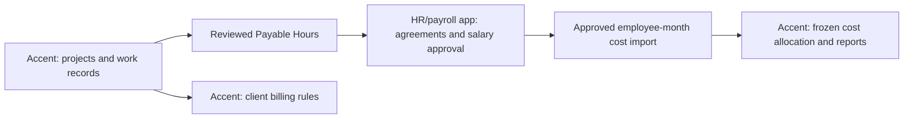

# Salary system recovery plan

**Status: proposed, 2026-11-17.** Diagnosis and target workflow only. No payroll code, production data, or pay policy changed.
No HR/payroll app was installed or provisioned. This is not an accepted replacement for the existing ADRs.

## Business requirements confirmed by the owner

- CAD engineers need hourly pay calculations.
- Admin employees and office help should not need project hours to earn their regular salary.
- “Contract” can mean a fixed-term engagement or a worker deployed to a client's company.
- Excel is probably the current approval source. This remains unconfirmed.
- The owner wants a salary workflow his father can operate without engineering intervention.

The hourly rate's contractual basis remains unconfirmed. An agreed hourly wage and monthly CTC converted to an hourly figure are different rules.
Gross earnings, net pay, and employer cost must also remain distinct.

## Recommendation

Evaluate **a separate Frappe HR instance, with the compatible India Payroll extension**, before another Accent payroll rewrite.
Prefer managed hosting with an identified support owner; no paid account or subscription is authorized by this plan.

Frappe documents monthly salary structures and timesheet-based salary structures with an Hour Rate:
[Salary Structure](https://docs.frappe.io/hr/salary-structure).
Its [Payroll Entry](https://docs.frappe.io/hr/payroll-entry) supports bulk calculation, review, and submission.
This makes it a credible candidate for the mixed workforce, not a proven fit for the company's rules.

The India extension is younger than the core. Validate required deductions, state rules, and exports with the accountant.
Do not treat advertised statutory automation as proof of a correct filing.
See the [open-source comparison](open-source-options.md) for licensing, maturity, and integration limits.

A separate app helps only if ownership changes. Running two writable salary systems would reproduce the current problem.
Do not introduce microservices, an event bus, a generic payroll formula engine, or another layer over the existing Salary Profiles.

## What the investigation established

### The business model does not match the universal formula

`src/utils/payroll-calculation.js:338-395` derives gross from CTC, month Basis Hours, and Logged Hours before inspecting Salary Type.
Consequently, `monthly`, `hourly`, and `contract` do not select different base-pay formulas.
This follows [ADR-0010](../../adr/0010-hours-logged-pay-basis.md), but conflicts with the owner's clarified mixed-pay requirement.
An implementation change must explicitly supersede that universal-pay decision, not quietly bypass it.

Salary Type also mixes pay basis with engagement labels. A deployed engineer can earn hourly or monthly pay.
A fixed-term office employee can earn monthly pay without project timesheets.
The directory category must not decide either person's pay formula or statutory treatment.

### History protections have no owner-operated reconciliation path

Read-only production aggregates showed:

- 108 Salary Profile rows, all with positive explicit CTC and a recorded start date.
- 14 non-deleted Employee records without either Joining Date or Hire Date; 10 are marked active.
- 664 known-month ambiguous legacy payroll-use records across 82 Employees; no unknown-month records in that result.

Known-month ambiguity protects candidate agreements and affected coverage periods. It does not block every future salary write.
See `src/lib/salary-profile-commands/commands.ts:455-567,1583-1591` and `src/lib/salary-profile-store.ts:526-579`.
The workspace exposes the restrictions, but provides no ambiguity-resolution command for the owner.
The backfill CLI deliberately operates only on disposable copies, not production.

Keep history protection. Provide a reviewed migration/reconciliation process instead of deleting use evidence or weakening guards.
Existing rollout status notes are historical: production metadata already contains the new fields and use ledger.
Their presence does not establish which application build is deployed.

### Draft payroll cannot substantiate the monthly cost report

Read-only production aggregates:

| Period | Saved slips | Run state | Positive CTC, zero Logged Hours and zero base gross |
| --- | ---: | --- | ---: |
| September 2026 | 76 | draft | 62 |
| October 2026 | 64 | draft | 53 |
| November 2026 | 59 | draft | 52 |

These are saved application records, not proof that employees received no salary outside Accent.
The relevant slips lacked source-qualified agreement provenance. Earlier February–July slips had no associated run record.

`loadPayrollMonth()` in `src/lib/company-expenditure/payroll.ts:743-890` counts recorded allocations only for locked runs.
For draft or run-less months, it calculates estimates using period-effective agreements and current Logged Hours.
It does not promote a saved draft slip into confirmed cost.
Thus the report can change while actual salary approval happens elsewhere.
Missing employment dates can also prevent pricing while leaving the employee's hours visible.

The shared reader is worth retaining. Its callers include monthly/FY reporting, expenditure reconciliation, and payroll drilldown.
LSP references confirmed those consumers; this is not a reason to create another report calculator.

### Closing one pay stream depends on the other

[ADR-0008](../../adr/0008-payroll-run-lock-and-route-tree.md) locks a single run across both streams.
Generation can exclude date-review cases, while finalization refuses them.
A successful generation therefore does not establish that the month can close.
A contract-side problem can prevent a payroll-side close.

The replacement must expose readiness before calculation and preserve a visible list of unresolved workers.
It must not silently omit people or call a partial month complete.

## Separate the business concepts

These definitions are recorded in the [glossary](../../../GLOSSARY.md).
They do not change the current Salary Type field or runtime behavior.

| Concept | Meaning | Example |
| --- | --- | --- |
| Pay Basis | How pay is earned | Monthly salary; agreed hourly wage |
| Employment Term | Duration of employment | Ongoing; fixed term |
| Client Deployment | Where the Employee is assigned | Office; a client's manpower assignment |
| Payable Hours | Time accepted for pay under the agreement | Reviewed CAD work plus other agreed pay codes |
| Client billing | What the customer owes under its contract | Billable hours at a separate client rate |

Do not migrate a `contract` label into a tax or legal classification.
The father/accountant must confirm who employs and pays each deployed worker.
Independent suppliers, if any, need their own reviewed treatment; deployment alone does not make someone a supplier.

## Proposed ownership

- The HR/payroll app is the single writer of new pay agreements and approved payroll after cutover.
- Accent owns Projects, work capture, Client Deployment, client billing, and cost allocation.
- The import transfers approved employer cost, not net pay or an inferred CTC amount.
- Use explicit external-employee-to-Accent-employee mappings. Never join payroll by email or names.
- Preserve one approved source per Employee and period. Do not count Accent and imported payroll twice.
- Salaried office staff must remain in company cost without project timesheets.
- Office cost becomes Company Overhead only through explicit classification. Missing attribution remains Unallocated Cost.

## The workflow the father should receive

1. Choose a pay period and see the expected roster.
2. See monthly-paid staff separately from hourly-paid staff, without redefining their employment categories.
3. Review missing terms, missing Payable Hours, and other exceptions before calculating.
4. Calculate pay and compare it with agreed terms and the prior approved period.
5. Review earnings, deductions, employer cost, and net pay separately.
6. Approve payroll, export the supported payment instructions, and record payment evidence.
7. See confirmed payroll cost in Accent without regenerating salaries there.

Unresolved workers must stay visible with their reason and next action.
The pilot must prove how ready workers can be processed without falsely certifying complete company coverage.
Payment evidence and payroll approval remain different facts.

## Recovery and cutover sequence

### 1. Establish the actual approved baseline

Obtain one completed salary register approved by the father/accountant, plus its period and approval evidence.
No salary/payroll-named workbook was found in the repository search.
Do not assume every draft slip, active Employee, or current profile represents approved historical pay.

Reconcile identity, pay basis, agreed amount, employment dates, deductions, employer contributions, and outstanding balances.
Include one hourly engineer, one salaried administrator, and one deployed worker.
Confirm payable-time rules, the hourly rate's basis, and treatment of non-project time.
Carry forward reviewed loan, advance, leave, and tax balances. Never reset or invent them during migration.

### 2. Prove the separate app before adopting it

Use a private isolated instance and anonymized representative data first.
Choose compatible supported Frappe/ERPNext/HRMS/India Payroll releases, not an unreviewed development branch.
Configure the two confirmed pay bases and the accountant-reviewed statutory treatment.
Do not blindly import legacy profile component totals or unused hourly/contract fields as agreed terms.

The pilot must reproduce an approved completed month or explain every reviewed difference.
A public demo or successful installation is insufficient evidence.

### 3. Make reporting accept approved payroll without fake Accent runs

Retain `loadPayrollMonth()` as the shared reporting seam and reuse the existing allocation calculations and review conventions.
Add an explicit accepted external-payroll source with file/system reference, period, mapped Employee, approved amount, and currency.
Retain source line identity, version, reviewer, approval time, and evidence reference.
Repeated imports must not create another cost; corrections need retained versions and reasons.

The existing reconstruction commands cannot accept this unchanged.
They require an existing Accent Payroll Slip and an already locked run, and derive cost from that slip.
See `src/lib/company-expenditure/reconstruction.ts:375-405,631-771`.
Allocation keys and readers are also slip-based and need an explicit source-aware migration.
Do not create synthetic slips or finalize old runs merely to satisfy those conditions.

Use the existing financial month-open and revision rules.
Show recorded Accent cost, approved external cost, estimates, and unknowns with distinct provenance.
Keep estimates outside confirmed totals. Page, drilldown, and Excel must render the same server-owned basis and completeness fields.

### 4. Approve one real cutover period

Choose the period only after the pilot and reconciliation pass.
Back up the data and prove restore before schema changes.
Freeze old salary writers for the cutover and migrate the approved new opening agreements and balances.
Only the selected payroll system may create new payroll for that scope after cutover.

Keep old slips, salary history, audit evidence, and ambiguous legacy links as a read-only archive.
Do not invent past agreement provenance. A reviewed external historical register remains an external source.
Retire old Accent generation and salary-edit entry points only once the new workflow and reporting import work end-to-end.

### 5. Prove owner operation and historical stability

The father must complete the monthly review without developer-only scripts or manual deletion of salary rows.
The accountant must sign off the payroll comparison and required statutory outputs.
Approve a second representative period before treating the workflow as established.

## Acceptance scenarios

- Monthly-paid office worker with no project hours still receives the agreed salary under the approved attendance policy.
- Hourly CAD worker earns the agreed amount from Payable Hours, not the customer's billing rate.
- A client-deployed worker retains the correct employment terms, pay basis, and independent billing rate.
- Missing agreement or hours is a named exception; the person never disappears from the expected roster.
- A salary revision does not reprice an approved earlier month.
- Reimporting the same payroll creates no duplicate cost.
- A later timesheet edit does not change frozen project costs without an approved allocation revision.
- Employee cost reconciles to direct Project cost, Company Overhead, and Unallocated Cost exactly once.
- Company totals include office staff without requiring project allocation.
- Unknown cost is not zero. Estimates are never described as actual approved payroll.
- Historical drafts do not become approved payroll merely because an import or migration ran.
- UI, Excel, and the payroll drilldown agree on period, basis, amounts, and completeness.

## Execution limits and next inputs

Only source inspection, LSP references, and read-only production aggregates were used for this diagnosis.
No application behavior was changed and no runtime fixes were claimed.

This workstation has neither Docker nor Frappe bench available. No approved HRM hosting target was provided.
A private evaluation target and authorization for any hosting expense are needed before provisioning.
The approved salary register and the exact hourly-pay agreement are needed before configuring real pay rules.
These are financial approval inputs, not values engineering should guess.

Before implementation, record the chosen ownership and mixed-pay rules in an explicit successor decision.
Reconcile its effects on ADR-0010, ADR-0008, ADR-0016, and ADR-0036.
The historical protections remain in force until an authorized cutover changes them.
