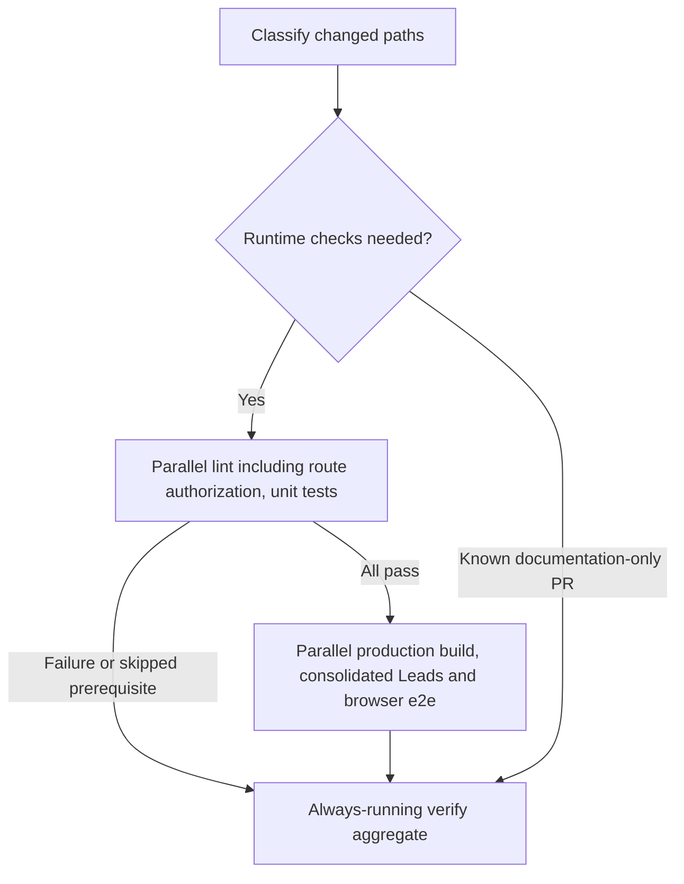

# Twenty testing architecture: adoption evidence

Research date: 2026-11-16. Source snapshot: `twentyhq/twenty` at commit
[`bd41bfa9e3754f66d390aef10e83a337ce7aeff1`](https://github.com/twentyhq/twenty/tree/bd41bfa9e3754f66d390aef10e83a337ce7aeff1).
Upstream research was read-only: no Twenty tests or workflows were launched.
Sections 7–8 describe Accent's native-tool adaptation, not a literal copy of Twenty's stack.

## 1. Shape

Yarn 4 workspaces under `packages/*`, orchestrated by Nx. **No test scripts at the root**: each layer is
an Nx target declared in a package `project.json`, with shared defaults in
[`nx.json`](https://github.com/twentyhq/twenty/blob/bd41bfa9e3754f66d390aef10e83a337ce7aeff1/nx.json)
(`appsDir`/`libsDir` = `packages`).

| Layer                 | Target                                               | Runner / config                                                                                                                                                                               |
| --------------------- | ---------------------------------------------------- | --------------------------------------------------------------------------------------------------------------------------------------------------------------------------------------------- |
| Server unit           | `twenty-server:test` (CI: `test:ci`)                 | Jest+SWC ([config](https://github.com/twentyhq/twenty/blob/bd41bfa9e3754f66d390aef10e83a337ce7aeff1/packages/twenty-server/jest.config.mjs))                                                  |
| Server integration    | `twenty-server:test:integration`                     | Jest+SWC, real Nest app ([config](https://github.com/twentyhq/twenty/blob/bd41bfa9e3754f66d390aef10e83a337ce7aeff1/packages/twenty-server/jest-integration.config.ts))                        |
| Secure integration    | `twenty-server:test:integration:secure`              | same harness, forced https `SERVER_URL` ([config](https://github.com/twentyhq/twenty/blob/bd41bfa9e3754f66d390aef10e83a337ce7aeff1/packages/twenty-server/jest-integration-secure.config.ts)) |
| Front unit            | `twenty-front:test` (inherits `targetDefaults.test`) | Jest+SWC, jsdom ([config](https://github.com/twentyhq/twenty/blob/bd41bfa9e3754f66d390aef10e83a337ce7aeff1/packages/twenty-front/jest.config.mjs))                                            |
| Front component/story | `twenty-front:storybook:test[:no-coverage]`          | **Vitest** browser mode + Playwright provider ([config](https://github.com/twentyhq/twenty/blob/bd41bfa9e3754f66d390aef10e83a337ce7aeff1/packages/twenty-front/vitest.config.ts))             |
| End-to-end            | `twenty-e2e-testing:test`                            | Playwright Test ([config](https://github.com/twentyhq/twenty/blob/bd41bfa9e3754f66d390aef10e83a337ce7aeff1/packages/twenty-e2e-testing/playwright.config.ts))                                 |

Jest and Vitest serve different test layers upstream; Playwright Test runs the E2E suite.
Commands are `npx nx test twenty-e2e-testing` and `npx nx run twenty-server:test:ci --shard=1/4`.

## 2. File conventions

- Server unit: `*.spec.ts` co-located in `src/`; `fakeTimers.enableGlobally`, `clearMocks`, `setupTests.ts`, coverage into `../coverage`.
- Server integration: `test/integration/**/<name>.integration-spec.ts` (`testRegex: '\.integration-spec\.ts$'`), domain folders
  (`graphql/suites`, `rest`, `workflow-actions`), plus `test/integration/utils/*` helpers (fixtures, token factories, record
  cleanup, job draining, container starters).
- Front unit: sibling `__tests__/` dirs per module; `TZ=GMT` and `LC_ALL=en_US.UTF-8` pinned; asset/CSS/worker mocks via `moduleNameMapper`.
- E2E: `tests/*.spec.ts`, `tests/login.setup.ts`, page objects under `lib/{pom,requests,fixtures,constants}`.

## 3. Isolation model (load-bearing)

One real backend, serial execution, suite-owned data — not per-test databases.

- `globalSetup` waits for a reset handshake, opens the raw data source, boots the app via `createApp()`, recomputes workspace
  cache, listens on `globals.APP_PORT`, exposes `global.app` / `global.testDataSource`
  ([setup-test.ts](https://github.com/twentyhq/twenty/blob/bd41bfa9e3754f66d390aef10e83a337ce7aeff1/packages/twenty-server/test/integration/utils/setup-test.ts)).
- `createApp` overrides provider seams (Stripe SDK, exception handler, captcha) and applies production CORS/session/upload
  middleware rather than stubbing HTTP
  ([create-app.ts](https://github.com/twentyhq/twenty/blob/bd41bfa9e3754f66d390aef10e83a337ce7aeff1/packages/twenty-server/test/integration/utils/create-app.ts)).
- `maxWorkers: 1`, `maxConcurrency: 1`, `testTimeout: 90000`; suites clean their own records through helpers.
- Reset is asynchronous and decoupled: CI backgrounds `nx database:reset`, writes `ready`/`failed` to
  `INTEGRATION_TEST_DB_RESET_STATUS_FILE`, suites poll it up to 10 minutes
  ([wait util](https://github.com/twentyhq/twenty/blob/bd41bfa9e3754f66d390aef10e83a337ce7aeff1/packages/twenty-server/test/integration/utils/wait-for-test-database-reset.util.ts)).
- E2E logs in once in a `setup` project, writes `storageState`, browser project depends on it; `workers: 1`, CI `retries: 2`,
  `trace: retain-on-failure`, CI expect timeout 15s.
- Backend fixtures: Postgres 18, Redis, ClickHouse; optional Okta SSO tenant; per-suite containers (Dovecot, GreenMail, Radicale,
  Floci) for messaging/calendar.

## 4. Cacheability, inputs, affected selection

`nx.json` named inputs: `default`, `excludeStories`, `excludeTests` (drops `*.spec.*`, `*.test.*`, `*.integration-spec.ts`,
`__tests__/*`, jest config, `tsconfig.spec.json`), `production`. `test` default: `@nx/jest:jest`, `cache: true`,
`inputs: ["^default","excludeStories","{workspaceRoot}/jest.preset.js"]`, `outputs: ["{projectRoot}/coverage"]`,
`cacheDirectory: ../../.cache/jest/{projectRoot}`, `dependsOn: ["^build"]`, `passWithNoTests: true`; `ci` adds `ci: true`.
`test:e2e` default: `cache: true`, `dependsOn: ["^build"]`. Integration targets are `nx:run-commands` wrapping
`nx jest --config …`, so the build is cached but the suites always run.

CI persists `.nx`, `.cache`, `node_modules/.cache`, `packages/*/node_modules/.cache` under `v4-<key>-<branch>-<sha>` with
branch/main `restore-keys`, saving only on a miss and never from fork PRs
([restore-cache](https://github.com/twentyhq/twenty/blob/bd41bfa9e3754f66d390aef10e83a337ce7aeff1/.github/actions/restore-cache/action.yaml)).

Affected selection ([nx-affected](https://github.com/twentyhq/twenty/blob/bd41bfa9e3754f66d390aef10e83a337ce7aeff1/.github/actions/nx-affected/action.yaml)):
fetch `origin/main` depth 1 → `nrwl/nx-set-shas` → fallback `origin/main` →
`npx nx affected --nxBail --outputStyle=stream --configuration=ci -t=<tasks> --parallel=3 --exclude="*,!tag:<tag>" <args>`.
Tags `scope:backend` / `scope:frontend` are the partition key; `!tag:` stops a job borrowing another package's tasks.
`--outputStyle=stream` is deliberate so a killed task still prints its stack trace.

## 5. CI staging, parallelism, retries

- [ci-front.yaml](https://github.com/twentyhq/twenty/blob/bd41bfa9e3754f66d390aef10e83a337ce7aeff1/.github/workflows/ci-front.yaml):
  path-filtered `changed-files-check` (`tj-actions/changed-files`) gates all jobs; `front-build`; `front-sb-build` (artifact,
  cached, 8-core runner); story tests in 8 (`modules`) + 4 (`pages`) + 4 (`performance`) shards; a screenshot-merge job;
  `front-task` matrix `[lint, typecheck, lingui:extract, lingui:compile, test 1/3, 2/3, 3/3]`; final `ci-front-status-check`
  runs `if: always()` and fails if any need failed.
- [ci-server.yaml](https://github.com/twentyhq/twenty/blob/bd41bfa9e3754f66d390aef10e83a337ce7aeff1/.github/workflows/ci-server.yaml):
  `server-build` → `server-test` (4 Jest shards, maxWorkers 3, `workerIdleMemoryLimit=1GB`, transform cache restored/saved),
  `server-validation` (DB init, worker boot, server boot + health poll, pending migration drift, GraphQL/SDK codegen drift),
  reusable `server-integration-test` (24 shards), `cross-version-upgrade`, public-app install smoke, then a status-check
  aggregator. Front **generated** GraphQL files sit in the server change filter because regeneration changes the contract.
- [ci-server-integration-test.yaml](https://github.com/twentyhq/twenty/blob/bd41bfa9e3754f66d390aef10e83a337ce7aeff1/.github/workflows/ci-server-integration-test.yaml):
  `services: postgres:18, redis, clickhouse`, `fail-fast: false`, 24 shards, 30-minute timeout, background DB reset, jest
  transform cache, optional timings artifact; secure suite pinned to shard 1. Sharding is **duration-aware**: a custom
  sequencer reads `INTEGRATION_TEST_TIMINGS_FILE` and bin-packs specs by recorded runtime, else falls back to Jest's split
  ([sequencer](https://github.com/twentyhq/twenty/blob/bd41bfa9e3754f66d390aef10e83a337ce7aeff1/packages/twenty-server/jest-integration-sequencer.cts)).
  Timings come from a weekly cron that reruns the full suite and merges per-shard durations into a 90-day artifact.
- [ci-e2e-main.yaml](https://github.com/twentyhq/twenty/blob/bd41bfa9e3754f66d390aef10e83a337ce7aeff1/.github/workflows/ci-e2e-main.yaml):
  push to main, plus PRs labelled `qa-scout` or `run-merge-queue` — **the browser suite is not a per-PR gate**. Builds front
  and server, copies `twenty-front/build` into `twenty-server/dist/front` so cookies are first-party, starts server + worker,
  runs Playwright once, uploads `run_results/` 7 days. The Claude "QA Scout" steps and comment job are fail-open extras, not
  test architecture.
- Concurrency: every workflow cancels superseded PR runs (`cancel-in-progress: ${{ github.ref != 'refs/heads/main' }}`);
  [merge queue](https://github.com/twentyhq/twenty/blob/bd41bfa9e3754f66d390aef10e83a337ce7aeff1/.github/workflows/ci-merge-queue.yaml)
  re-runs a narrow guard so a required check exists in both contexts.

## 6. Transferable patterns

The selected patterns are separate test layers, real-backend integration, conservative changed-path selection,
failure artifacts, cancellation of obsolete PR runs, and an always-running aggregate status.

Other upstream techniques depend on their scale or framework: Nx's project graph, Yarn workspaces,
Nest providers, a background database-reset handshake, Storybook, multiple backend services,
large shard matrices, and shared browser authentication. They are not prerequisites for Accent's migration.
The source does not establish that those mechanisms would make Accent's single browser journey faster.

The inspected Twenty configuration does not use Next.js-style passed-file caches or dev/prod test variants; neither is introduced.
No upstream application or harness code is copied.

## 7. Accent implementation

Accent retains npm, Node 24, Vitest, Playwright Test, and every existing test.
No Nx, Yarn, Jest, Storybook, application-layout, or database-engine migration is introduced.

```sh
# Focused local feedback.
npm test -- src/lib/money.test.ts --watch
npm run test:unit -- src/lib/money.test.ts

# Complete native layers.
npm run test:unit
npm run test:integration

# Routine browser verification: GitHub Actions only.
# Local debugging still requires explicit authorization and --local-run-reason.
```

`test:unit` replaces `test:run`; `test:integration` replaces `test:integration:leads`.
The native Vitest UI/coverage commands remain available. No test-result cache or optional reporter dependency is added.
See [package scripts](../../package.json), [CI workflow](../../.github/workflows/checks.yml),
and [testing standards](../../CODING_STANDARDS.md#testing-and-verification).



The classifier permits skipping only nonempty PR changes entirely inside `docs/` or the exact known root documentation files.
Source, tests, scripts, CI, dependencies, migrations, mixed changes, empty comparisons, and uncertain metadata select all checks.
Git comparison disables rename detection so a runtime file moved into documentation still selects runtime checks.
Pushes to `main` and `master` retain complete verification.
For PR selection, CI executes the classifier from the base revision, not the changed PR files.
A missing base classifier or uncertain base metadata selects all runtime checks.
This prevents a classifier regression from skipping its own tests.

The current jobs are `changes`, `lint`, `unit-tests`, `build`, `e2e`, and the always-running `verify` aggregate.
`lint` includes the `accent/require-route-auth` rule, so route authorization has no separate job.
The rule proves an approved guard call exists in each exported method's reachable path, not that the handler returns the deny branch or checks the right permission; API tests keep proving `401` and `403` behavior.
The `e2e` job runs the Leads authenticated HTTP integration and the Playwright suite on one runner with one MariaDB 10.11 service;
each harness still creates its own disposable database, starts and owns its Next process, and reports through its own step.
A Leads failure does not block the browser step; a final step restores job failure so neither result is masked.
Additional jobs expose lint, unit, build, and change-selection results separately.
The aggregate requires successful change selection and every expected result.
It accepts intentional runtime skips only for a confirmed documentation-only PR.
Failures, cancellation, missing results, and unexpected skips fail the aggregate.

Unit failures produce a native JUnit report; browser failures retain existing Playwright artifacts.
Reports use ignored artifact directories. Standard Ubuntu runners and npm dependency caching remain;
no paid capacity, remote test-result cache, or new cloud service is configured.

## 8. Deliberate differences from Twenty

- **Native targets:** command names describe Accent's layers; Twenty's fast target is named `test`, not `test:unit`.
- **CI gating:** Twenty's expensive jobs are path-filtered, not uniformly test-gated.
  Accent additionally requires cheap checks before starting builds, databases, and browsers.
- **Integration:** the existing owned MariaDB HTTP harness remains intact and now shares one `e2e` job and database service with the browser suite.
  Its migrations finish before the app starts, so no asynchronous reset handshake is needed.
  Existing scenarios, ordinary authentication, fixture cleanup, and independent database assertions are preserved.
  The two harnesses still provision separate databases and Next processes; sharing the runner does not merge their fixtures or lifecycle.
- **Browser scope:** Twenty restricts PR E2E by labels. Accent retains its one financial journey on every runtime-changing PR.
  The journey still proves real sign-in; replacing that assertion with shared authentication is not equivalent coverage.
- **Selection:** native path filtering replaces the monorepo affected graph.
  It skips documentation-only runtime work, not tests whose HTTP or database dependencies cannot be inferred.
- **Sharding and caching:** no artificial shards or green-result cache are introduced for one browser journey.
  Existing dependency caching remains; integration and browser results are never reused as proof.
- **Coverage:** local `verify` runs tests, not coverage collection.
  Existing coverage commands are unchanged; this migration does not fabricate a new coverage threshold.
- **Enforcement:** workflow YAML is not branch protection or a billing cap.
  Required merge checks still need repository administrator access, which the current account lacks.
- **Deployment:** Vercel configuration is unchanged. This work does not claim deployments wait for CI.

Files reviewed upstream include `nx.json`, front/server/E2E project and runner configs,
the CI workflows linked above, affected/cache actions, integration setup, and app factories.

## 9. Authoring-checkout verification

- `npm run test:unit` with the CI default/JUnit reporters passed **2,133 tests in 177 files**.
  Vitest reported 76.94 seconds and wrote the ignored JUnit artifact.
- Targeted ESLint and TypeScript checks passed for the native scope helpers and their regression tests.
- Workflow YAML, the then-current eight job identifiers, aggregate dependencies, standard runners, and canonical npm callers were checked.
- Fourteen executable scope/gate scenarios passed using a disposable Git repository.
  They covered documentation skips, source changes, renames, deletions, uncertain metadata, output failures, and browser-failure propagation.
  The fixture was removed.
- Those authoring checks started no real database, application server, browser suite, or production build.

## 10. Isolated mainline push verification

- The push candidate is based on `origin/main`, excluding the unrelated unmerged payroll branch and its staged work.
- `npm run verify` passed under Node **24.22.3**: route authorization (then a separate `check:route-auth` step, since folded into ESLint), lint, **2,102 tests in 175 files**, and production build/typechecking.
  The authorization check covered 477 handlers across 267 route files. ESLint reported warnings but no errors.
- Counts differ from the authoring checkout because its unrelated payroll changes are not part of this candidate.
- Six executable workflow-step scenarios passed using the base-revision classifier:
  first adoption without a base helper, documentation-only changes, a tampered PR classifier, missing/invalid metadata, and pushes.
  Temporary Git fixtures and extracted helpers were removed.
- No local E2E, real-database integration, or production migration was run for the push.
- At commit time, the new workflow had not yet executed in GitHub Actions.
- The consolidated `e2e` job and the lint-enforced route authorization were documented from workflow and configuration changes; this record makes no claim that the merged layout has run in CI.
